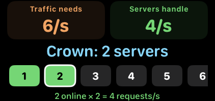
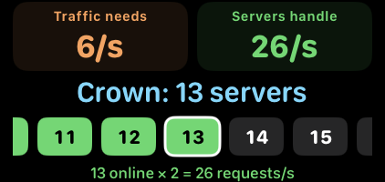
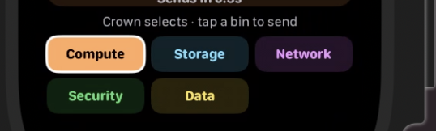

# AWS Revise Watch

A standalone watchOS companion for fast AWS SAA-C03 recall. The deck contains more than 100 cards covering service limits, service choices, architecture patterns, and common exam distinctions. Content is bundled on the watch for offline play.

## Use on Apple Watch

Open `AWS Revise Watch.xcodeproj` in Xcode, choose the **AWS Revise Watch** scheme, set your signing team if Xcode asks, and run it on an Apple Watch or watchOS Simulator.

- The **Study** home screen scrolls, so every mode and domain remains reachable on smaller Watch displays.
- **Quick Review** presents full-height, scrollable cards: tap to reveal, then use **Again** or **Got it**. The latter increments your local review count.
- **Crown Arcade** is a watch-native skill hub with three compact games (no quiz confirmation screens):
  - **Service Catcher**: turn the Digital Crown to steer a collector, catch the glowing target category, and dodge wrong services and red hazards. Falling speed increases, lives and combos matter, and the result screen shows an AWS architecture fact.
  - **Service Sorter**: all five destination bins stay visible. Turn the Crown deliberately to move one bin at a time (accelerated events cannot skip bins); tap any bin to send immediately or let the countdown send to the highlighted bin; the first card allows six seconds, answers stay visible briefly, and five mistakes end the run.
  - **Scale Ops**: first complete an untimed, cost-free add/remove-server exercise, then run a 42-second flash sale. The Crown sets 1–16 desired instances; the numbered server strip slides smoothly in either direction to keep the selected count visible, including counts above eight. Tap a visible chip to choose it directly. A two-second provisioning delay separates desired from online capacity. The online-server throughput formula, traffic/capacity comparisons, a forecast, queue, and budget make the availability–cost tradeoff visible. Three queue overflows or an empty budget end the run. Timing and costs are simplified game units, not AWS estimates.
  Each game has a concise how-to screen, Crown controls without arrow buttons, a pause/resume overlay, a padded results view with pinned Replay/Arcade actions, and a persisted best score. Leaving the app pauses an active run so time never drains in the background and a run never auto-resumes.
- Choose from six learning modes: Quick Review, Sprint Quiz, Scenario Lab, True / False, Match-Up, and Daily Mix.
- Mixed modes draw 36 prompts across AWS domains. Focused domain reviews use the cards available for that domain. The card order rotates daily so more of the deck appears across sessions.

The app is intentionally independent of an iPhone companion so it can be installed directly on the watch.

## Watch screenshots

Scale Ops keeps fixed-size server chips readable as selection moves through 1–16. The strip follows the selected count in both directions; the white outline marks the request, green marks online capacity, and amber marks a capacity change.

| Low server count | Scrolled beyond eight |
| --- | --- |
|  |  |

The Scale Ops snips above were captured from the updated app on Apple Watch Ultra 3. Service Sorter keeps every destination visible:

## AWS content sources

The static deck was refreshed against official AWS documentation on **October 7, 2026**. AWS service quotas and certification coverage can change; the app does not fetch live AWS data. In particular, the SQS message limit is 1 MiB, the S3 object limit is 50 TB, Aurora storage can grow to 256 TiB, and the default API Gateway REST integration timeout is 29 seconds with an increase available for Regional and private REST APIs.

- [SAA-C03 exam guide](https://docs.aws.amazon.com/aws-certification/latest/solutions-architect-associate-03.html)
- [SQS message quotas](https://docs.aws.amazon.com/AWSSimpleQueueService/latest/SQSDeveloperGuide/quotas-messages.html)
- [S3 object sizes](https://docs.aws.amazon.com/AmazonS3/latest/userguide/UsingObjects.html) and [upload methods](https://docs.aws.amazon.com/AmazonS3/latest/userguide/upload-objects.html)
- [Aurora storage scale](https://docs.aws.amazon.com/rds/latest/auroraextendedcontent/aurora-faq-scalability.html)
- [API Gateway REST quotas](https://docs.aws.amazon.com/apigateway/latest/developerguide/api-gateway-execution-service-limits-table.html)
- [EventBridge Pipes](https://docs.aws.amazon.com/eventbridge/latest/userguide/eb-pipes.html), [S3 Express One Zone](https://docs.aws.amazon.com/AmazonS3/latest/userguide/directory-bucket-high-performance.html), [DynamoDB global tables](https://docs.aws.amazon.com/amazondynamodb/latest/developerguide/GlobalTables.html), and [Bedrock Knowledge Bases](https://docs.aws.amazon.com/bedrock/latest/userguide/kb-how-retrieval.html)

The Scale Ops lesson is informed by [EC2 Auto Scaling instance initialization and warmup](https://docs.aws.amazon.com/autoscaling/ec2/userguide/ec2-auto-scaling-default-instance-warmup.html). The simulation compresses startup and capacity changes for play; its two-second delay and budget do not represent AWS guarantees or prices.

## Arcade validation

Run `swiftc "AWS Revise Watch App/AWSArcadeLogic.swift" ArcadeLogicHarness.swift -o /tmp/aws-arcade-logic && /tmp/aws-arcade-logic` for the production-rule harness. It covers accelerated Crown input, jitter/reversal cadence, category traversal and tap mapping, server selection above eight and back to one, guided practice, feedback timing, pause behavior, provisioning delay, queue overflow, budget exhaustion, and complete Scale Ops strategies. A forecast-following policy survives; always-minimum capacity loses availability, and always-maximum capacity exhausts its budget.
